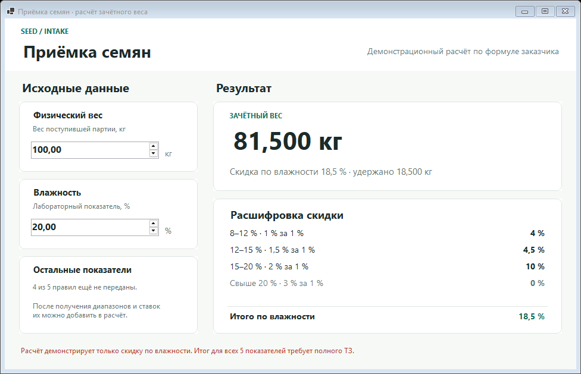

# Калькулятор приёмки семян

Демонстрационное Windows-приложение для расчёта зачётного веса семян по лабораторному показателю влажности. Формула взята из [опубликованного примера заказа](https://www.fl.ru/projects/5525664/sozdat-legkoe-prilojenie-dlya-pk.html): скидка накапливается по диапазонам влажности и вычитается из физического веса.



При весе **100 кг** и влажности **20 %** приложение рассчитывает скидку **18,5 %** и зачётный вес **81,5 кг**. Интерфейс показывает вклад каждого диапазона.

## Запуск

На Windows 10/11 распакуйте [`seed-intake-calculator-app.zip`](seed-intake-calculator-app.zip) и запустите `SeedIntakeCalculator.exe`. Нужен установленный [.NET 8 Desktop Runtime](https://dotnet.microsoft.com/download/dotnet/8.0). Файлы DLL и JSON в архиве должны оставаться рядом с EXE.

Для запуска из исходников нужен .NET 8 SDK:

```powershell
dotnet run --project .\SeedIntakeCalculator.csproj
```

Проверка примера и границ диапазонов:

```powershell
dotnet run --project .\SeedIntakeCalculator.csproj -- --self-test
```

## Статус

Это прототип по одному из пяти лабораторных показателей. Для полного расчёта нужны правила остальных четырёх, способ объединения скидок, правила округления и поведение при влажности ниже 4 %. Пока этих данных нет, приложение не выдаёт частичный результат за полный расчёт партии.
